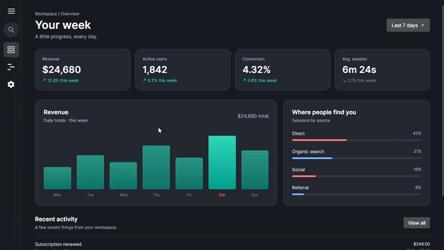

# Avalonia Glass SideBar

A collapsible navigation sidebar for Avalonia UI with an acrylic blur background. It features an expanding search bar, smooth open/close animations, and built-in Dark and Light themes.



## Quick Start

**1. Install the blur dependency**  
The acrylic background uses [Fluid.Avalonia.Acrylic](https://www.nuget.org/packages/Fluid.Avalonia.Acrylic):
```bash
dotnet add package Fluid.Avalonia.Acrylic

```

**2. Copy the files**

Copy the [`Controls`](https://github.com/hinata-net/Avalonia-GlassSideBar/tree/main/src/GlassSideBar/GlassSideBar.Demo/Controls) folder into your project.

**3. Include the resources**

Add `GlassSideBarResources.axaml` to your `App.axaml`:

```xml
<Application.Resources>
    <ResourceDictionary>
        <ResourceDictionary.MergedDictionaries>
            <!-- Replace 'YourAppNamespace' with your project namespace -->
            <ResourceInclude Source="avares://YourAppNamespace/Controls/GlassSideBarResources.axaml"/>
        </ResourceDictionary>
    </ResourceDictionary>
</Application.Resources>

```

**4. Add the control**

```xml
<controls:GlassSideBar MenuContent="{Binding Items}" />

```

See [`GlassSideBarDemo.axaml.cs`](https://github.com/hinata-net/Avalonia-GlassSideBar/blob/main/src/GlassSideBar/GlassSideBar.Demo/GlassSideBarDemo.axaml.cs) for an example of setting up menu items.

## Links

* [YouTube](https://www.youtube.com/@hinata-net)
* [Telegram](https://t.me/hinatadotnet)

## License

MIT
